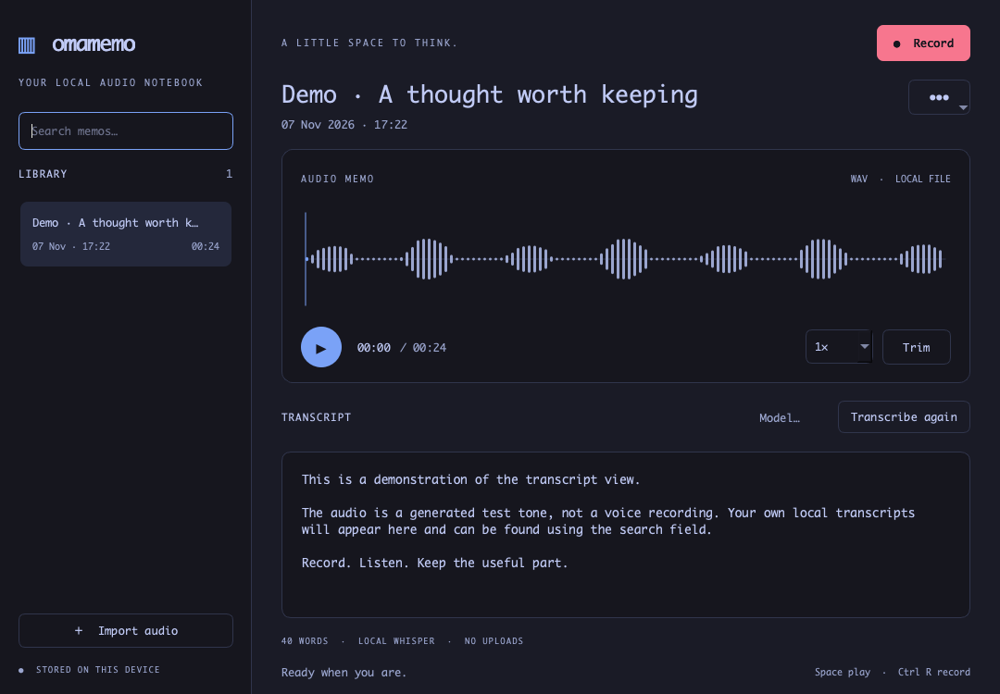

# Omamemo

A local voice memo app for Omarchy and Linux. Capture a thought, find it by title
or transcript, and keep the audio on your machine.



*Actual app interface with demonstration content.*

[Watch the 25-second walkthrough](assets/demo.gif): search, seek, trim a copy,
and switch between light and dark appearances. It uses a generated sample tone
and supplied transcript; microphone recording and transcription are not demonstrated.

**Early preview · Python 3.11+ · PySide6 / Qt Widgets · MIT**

Omamemo is an independent community project, unaffiliated with Omarchy.

## What it does

- Record the default microphone through PipeWire.
- Organize, rename, and search memos by title or transcript.
- Play, seek, and adjust playback speed with Qt Multimedia.
- Import audio supported by FFmpeg; export WAV or MP3.
- Trim to a new memo while preserving the original.
- Transcribe on your machine with whisper.cpp and a model you supply.
- Follow the active Omarchy palette, including changes while the app is open.

No account, API key, cloud transcription, or automatic model download. The
recording waveform is an activity indicator; saved memos show actual audio peaks.

This is an early release. Automated coverage exercises library operations,
recording lifecycle with controlled subprocesses, transcription integration with
a stub CLI, and offscreen UI interactions. Real microphone capture and Whisper
model inference still need validation on target hardware.

## Install on Omarchy / Arch

```sh
sudo pacman -S --needed git python pyside6 qt6-multimedia qt6-wayland ffmpeg pipewire pipewire-audio
git clone https://github.com/alexissan/omamemo.git
cd omamemo
./install.sh
~/.local/bin/omamemo
```

You can also download and unpack a release, then run `./install.sh` from its
folder. Launch **Omamemo** from your application menu after installation.

A running PipeWire session and an available microphone are required for
recording. Arch's Qt package is [`pyside6`](https://archlinux.org/packages/extra/x86_64/pyside6/);
Qt Multimedia must be installed separately. `pw-record` is supplied by
[`pipewire-audio`](https://archlinux.org/packages/extra/x86_64/pipewire-audio/files/).

The installer checks dependencies and uses `/usr/bin/python` with distro Qt. It
copies the app to `~/.local/share/omamemo-app`, adds `~/.local/bin/omamemo`, and
installs a user desktop entry and icon. It never runs `sudo`, installs system
packages, or downloads Python packages. Re-run it to update the installed copy.

To update a Git checkout, close the app, then run:

```sh
git pull --ff-only
./install.sh
```

## Use it

Click **Record**, then **Stop & save** when finished. Select a memo to play it,
inspect its waveform, or create a trimmed copy. **Import audio** adds an existing
file. The memo menu contains rename, export, and move-to-Trash actions.

| Shortcut | Action |
| --- | --- |
| Ctrl+R | Record / stop and save |
| Space | Play / pause |
| Ctrl+F | Search the library |

Record and playback shortcuts are suppressed while editing text.

### Optional local transcription

```sh
sudo pacman -S --needed whisper-cpp
```

Obtain a compatible whisper.cpp GGML model, select it with **Model…**, then click
**Transcribe locally**. `whisper-cli` must be on `PATH`. Models are separate from
the app; their size, language support, speed, and accuracy vary. Audio is passed
to the local process, and the resulting transcript is saved in the memo library.

## Your data

The default library is `~/.local/share/omamemo/`:

| Path | Contents |
| --- | --- |
| `audio/` | Managed mono PCM WAV recordings |
| `memos.sqlite3` | Titles, dates, waveform peaks, and transcripts |
| `recovery/` | Retained captures after an interruption or save failure |
| `trash/` | Audio moved to Trash |

`XDG_DATA_HOME` changes the data parent for both the app and library. Back up the
whole library directory while Omamemo is closed. For a separate library:

```sh
omamemo --data-dir /path/to/my-memos
```

Imports make managed copies; trims create new memos. PCM WAV can use more disk
space than compressed source audio. Export supports `.wav` and `.mp3` and refuses
to overwrite an existing file.

### Recover audio

If a capture fails, the error gives the retained file's path under `recovery/`.
Choose **Import audio** and paste that path into the file chooser to import a
usable WAV. The recovery file is preserved.

Deleted WAVs in `trash/` can also be imported as new memos. This restores audio
only: previous transcripts remain in the original database record and are not
transferred to a new import. There is no in-app Trash restore command.

Version 0.1.1 corrects normal PipeWire shutdown being mistaken for a save failure.
A quiet exit code 1 after an intentional stop is accepted only when the captured
WAV passes validation. Previously retained recordings can be imported as above.

## Themes

Omamemo reads `colors.toml` from either active-theme location:

- Omarchy 4: `~/.local/state/omarchy/current/theme/colors.toml`
- Omarchy 3: `~/.config/omarchy/current/theme/colors.toml`

It refreshes the palette while running and uses a built-in palette if neither
file is available. It does not change Omarchy configuration.

## Remove the app

Close Omamemo and run:

```sh
~/.local/share/omamemo-app/uninstall.sh
```

Or run `./uninstall.sh` from the source directory. **Your recordings, transcripts,
and custom libraries are retained.** System packages and Whisper models are
also retained. Use the same `XDG_DATA_HOME` value if you customized it at install
time. Delete a retained library yourself only when you no longer need its audio.

## Development and other installations

With the system dependencies installed, run from the source directory:

```sh
/usr/bin/python -m omamemo
```

A standard pip installation is also supported:

```sh
python -m venv .venv
.venv/bin/python -m pip install .
.venv/bin/omamemo
```

Pip may download PySide6 and build dependencies. FFmpeg, PipeWire, and whisper.cpp
remain system tools. The pip and local-script installations are independent;
remove a pip installation with its environment's `python -m pip uninstall omamemo`.

For regression tests, use an environment with PySide6, FFmpeg, and pytest:

```sh
QT_QPA_PLATFORM=offscreen python -m pytest tests -q
```

Capture the real window with `omamemo --screenshot /tmp/omamemo.png`. An offscreen
Qt platform can be used for layout checks without a display session.

### Running in a virtual machine

Run the Linux installer inside the Omarchy guest. A shared folder can supply the
source tree; installation copies the app to the guest's user directory. Keep the
memo library on the guest disk. Shared 9p folders may not support the writable
memory mapping required by SQLite WAL, so avoid placing `--data-dir` or
`XDG_DATA_HOME` there.

## Troubleshooting

- **Qt import or platform errors:** install `pyside6 qt6-multimedia qt6-wayland`
  for the system Python. A pip environment does not supply packages to
  `/usr/bin/python`.
- **No microphone:** check the running PipeWire session and default input device.
  `pw-record` must be on `PATH`.
- **Import/export failure:** check `ffmpeg` and `ffprobe`, input audio, and folder
  permissions. Export to a new WAV or MP3 filename.
- **Playback unavailable:** check Qt Multimedia and your audio output device.
- **Transcription unavailable:** check `whisper-cli` on `PATH` and the selected
  model file. Other features work without a transcription model.

See [CHANGELOG.md](CHANGELOG.md) for release changes and [LICENSE](LICENSE) for the
MIT license. Issues and reproducible bug reports are welcome.
